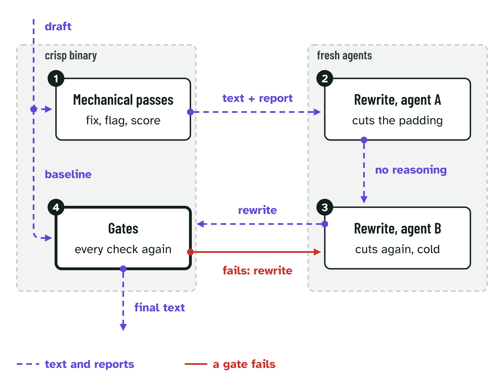
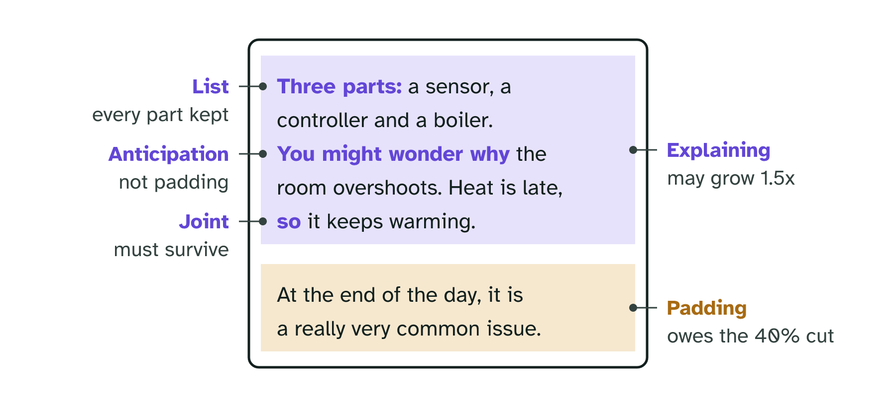
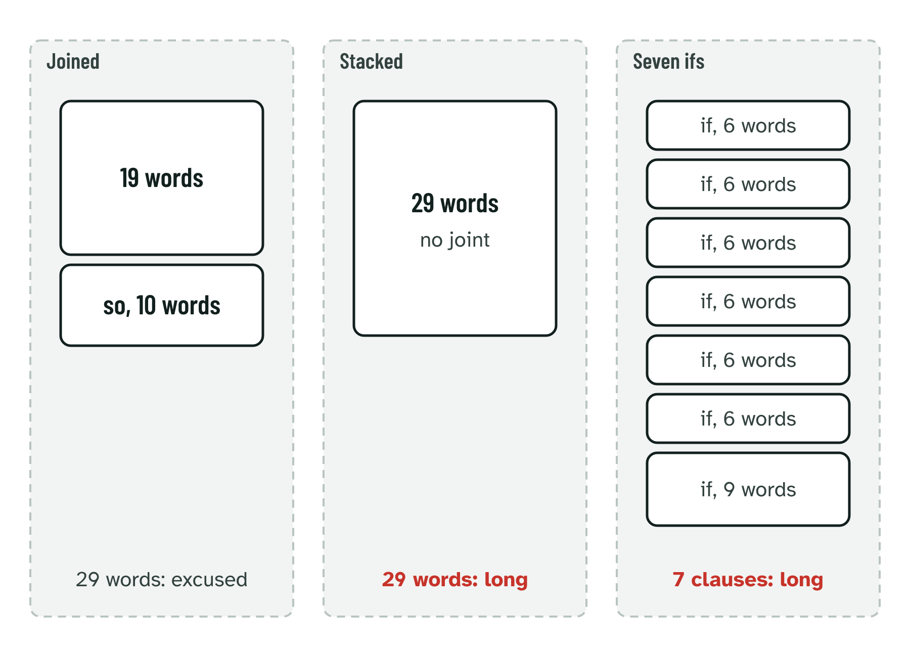

# crisp

A deterministic prose-quality engine: strip the machine fingerprints, cut the
clutter, and measure whether a document is harder to read than it needs to be.

It exists because "this is too complex" was an opinion you could argue with.
`crisp simplify --check` turns it into a test that exits 1. `--baseline` does the
same for "this is too long": measure the rewrite against the source it came from
and fail it if fewer than a quarter of the words are gone.

## What it is

One pure, offline Rust binary, `crisp`, and the rule tables that drive it. No
network, no state. Build it with `cargo build --release`.

| | |
|---|---|
| `crisp detell` | Strips typographic AI tells (em dashes, curly quotes, invisible unicode). Flags the meaning-changing ones rather than rewriting them. |
| `crisp simplify` | Cuts Zinsser's clutter ("prior to" to "before") and pure padding ("it should be noted that", "end result"), flags complexity (passive voice, buried verbs, filler, abstraction), and scores against a readability budget and a length gate. |
| `crisp grammar` | Flags grammar slips and American spellings, in British English, using [Harper](https://github.com/automattic/harper). Never rewrites. |

The library has one more kind that the binary does not report: **gap**, an
acronym used before it is explained (`src/gaps.rs`). It judges an absence rather
than a phrase, so it carries a hint, never a rewrite, and it is a fix only when
a caller hands it a glossary that has the expansion. Given the texts of a
book's earlier entries too, it spaces repeats: an acronym is flagged again only
once 8 entries have passed since the book last explained or flagged it; given
none, it judges the document on its own. ink asks for it on its own call;
`review` and the CLI never run it.

The split that matters is **FIX vs FLAG**. A FIX has exactly one correct plain
equivalent, so a script applies it. A FLAG changes meaning, so the script only
locates it and says why; a human or an agent decides. The scripts never quietly
reweight what you said.



*Two deterministic passes of the crisp binary around two rewrites by fresh
agents. The second agent gets the first one's text, never its reasoning, and
the gates measure the rewrite against the original draft.*

crisp began as two Python scripts. The Rust was held byte-identical to them
until they retired on 14 Oct 2026; `docs/rust.md` has the story.

[`research/`](research/) keeps track of who did this before: the reading research
behind the rules, the prior art for each of crisp's gates, a timeline of prose
tools from Strunk to the AI-tell skills, and how regular expressions became
grammars.

## Use

```bash
# clean a draft and check it against the budget and the length gate
target/release/crisp detell < draft.md 2>/dev/null \
  | target/release/crisp simplify --report --check --baseline draft.md > clean.md

# filing an insight: adds the structure gate on top of the budget
target/release/crisp simplify --report --check --insight draft.md

# measure only, with ranges: for editors and other programs
target/release/crisp simplify --locate draft.md

# add positioned sentences and paragraphs, for a live indicator
target/release/crisp simplify --locate --spans draft.md

# grammar and spelling, British English; text passes through, findings on stderr
target/release/crisp grammar --report draft.md > /dev/null
```

`--locate` returns every finding with a 1-based `line`/`col`/`end_line`/`end_col`
range over the unmodified input, plus a `fix` on clutter findings and a `hint` on
the judgement ones. It is the mode a consumer should build against.

`--spans` adds every sentence and paragraph with the same range shape and its
word count. The metrics say the longest sentence is 65 words; the spans say
where it is.

`--baseline` names the document the input was rewritten from and adds one line to
the report: `412 -> 240 words, cut 41.7%   target >= 40.0%`. Every other metric
is a ratio, so a document can sit inside all of them and still be twice as long
as it needs to be. Length is the one thing a per-sentence measure cannot see, and
it is usually the biggest win available.

The 40% is owed by padding, not by explanation. With `--baseline`, each source
paragraph is scored on its joints (because, so, but, if...), definitions,
unpacked lists and anticipations per sentence, less its padding, and each
rewrite sentence is traced to the source paragraph it shares most content
words with, so padding run into an explanatory paragraph is still padding. Each side then meets its own quota: the words that are not
explaining must lose 40% of their own count, and the explaining words may grow
to at most 1.5x theirs. Neither pays for the other, and the report shows both
under the LENGTH line (`padding 38 -> 22 words, cut 42.1%   target >= 40.0%`,
`explanation 131 -> 131 words, at most 196 (1.5x)`). Two more lines then gate
the rewrite: `JOINTS` fails if the rewrite has fewer joints than it owes, where
every joint in an explanatory paragraph is owed even if its sentence was cut
and a joint elsewhere only if its sentence survived, and `LISTS` fails if "it
has three parts" lost one of its parts. The research behind this is in
`references/simplify.md` Part E.



*What the explanation gates look for in a source paragraph, and what each kind
of paragraph owes the length gate.*

The sentence budget knows the difference too. Inside an explanatory paragraph, a
long sentence is excused when its joints break it into at most three clauses of
25 words or fewer, 45 words in all; the report lists it under `JOINED
SENTENCES` and keeps the true length on the scorecard.



*Long because joined is not long because stacked.*

`--insight` adds a structure gate for a document being filed to the product
backlog: the four template sections must be present, significance must be exactly
one value, and no internal code references or customer commercial numbers may
survive. None of the prose metrics can see those. Opt-in: absent the flag,
nothing changes.

Exit codes: 0 is a pass. 1 is `--check` over the budget or a failed gate
(LENGTH, JOINTS, LISTS, `--insight`). 2 is a usage error, unreadable input, or
output crisp could not write (a broken pipe, a full disk), so a caller can tell
a broken run from a failed draft.

Full usage, including the agent-facing workflow, is in [SKILL.md](SKILL.md). The
writing rules behind the judgement calls are in
[references/simplify.md](references/simplify.md) (Zinsser and Strunk & White,
plus what must never be simplified away) and
[references/voice.md](references/voice.md).

## Installed as a Claude Code skill

`~/.claude/skills/crisp` is a symlink to this repo, so the working copy and the
installed skill are the same files:

```bash
ln -s "$PWD" ~/.claude/skills/crisp
```

## Tests

`cargo test` after touching a rule table, the budget, or the locating arithmetic.

- `tests/golden.rs` pins `fixtures/` output, the binary's reports byte for byte,
  the edge cases in `fixtures/cases/`, *and the tunables themselves*. Pinning
  output alone leaves a hole: a threshold can move with no fixture straddling
  it, which is how a budget change once landed silently. On a diff, decide.
  Intended means re-record with `CRISP_UPDATE_GOLDEN=1 cargo test --test golden`
  and let the `golden.json` diff be the review. Unintended means you just
  changed something a consumer depends on.
- `tests/invariants.rs` slices the buffer at every reported range and requires
  the slice to equal the reported text, checks nothing inside code was reported
  and that findings come back sorted. Silent off-by-one drift is what it catches.

## Notes for anyone porting the rules

The rule tables are the program. Adding a tell is one line, not a branch.

If you reimplement this in another language, `fixtures/` and `fixtures/golden.json`
are the cross-implementation contract: run your port over the corpus and require
it to reproduce the recorded output. Divergence in a prose linter is worse than
absence, because a linter that quietly disagrees with the gate teaches the writer
the wrong lesson.

Three traps in the segmentation, all of which were silent here first. A port will
meet all three.

**Inline code splits its own sentence.** `prose_spans` returns code-free
*fragments*, so one `` `code` `` span mid-sentence yields two units. Do not
remove code to segment: **mask** it, same length, newlines preserved, so
offsets stay true and the prose stays contiguous. Removing it is still correct
for counting.

**`**Bold sentence.**` cannot be split.** The terminal `.` is followed by `*`,
which is not in `_SENT_END`'s trailing class, so the boundary is invisible. Blank
emphasis for sentence splitting only. Block-unit detection has to keep it, or
`* ` stops reading as a list marker.

**A greedy link match eats prose.** `\S+` in a URL pattern swallows the closing
paren of `[text](url)`, leaving `[text](` unclosed. The link rule then runs to the
next `)` anywhere in the document, replacing everything between with the link
text. One match here ate 826 characters, and every metric under-reported on
any document containing a link. Stop URLs before `)`, and forbid the link rule
from crossing a newline.

The lesson underneath all three: **assert the invariant, not just the output.**
`check_spans()` requires the positioned segmentation and the aggregate metrics to
agree on sentence count, paragraph count, max words and total words. It caught
all three, and two of them survived a seven-document fixture corpus that passed
clean. It took genuinely messy real prose to break them, so put some in your
corpus.
